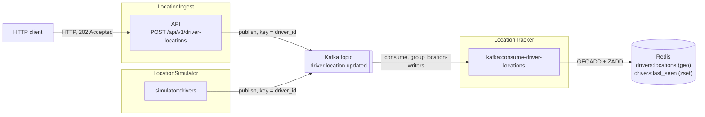

# ride-stream

ride-stream is a simple Uber-like ride-hailing backend. It shows an event-driven architecture with Laravel, Kafka and Redis, all running in Docker.

## Architecture

Driver positions flow through the system like this:



- **API** (`Modules/LocationIngest`): `POST /api/v1/driver-locations` validates a driver's coordinates and publishes them to Kafka, then returns `202 Accepted`.
- **Kafka topic** `driver.location.updated`: 6 partitions, messages keyed by `driver_id`, so one driver's updates stay in order. The topic is created by the `kafka-init` Compose service.
- **Consumer** (`Modules/LocationTracker`): the `kafka:consume-driver-locations` command reads the topic and writes to Redis. It skips malformed, invalid and stale (not newer than the last stored) messages.
- **Redis**: holds each driver's current position and last-seen time (see [Redis data model](#redis-data-model)).
- **Simulator** (`Modules/LocationSimulator`): moves several drivers along pre-fetched Kyiv routes and sends their positions. See the [simulator README](Modules/LocationSimulator/README.md) for options. It publishes straight to the Kafka topic, not through the HTTP API.

The code is split into Laravel modules (`Modules/`). Code shared between modules lives in `app/Shared`.

## Tech stack

- PHP 8.3, Laravel 13, [nwidart/laravel-modules](https://github.com/nWidart/laravel-modules)
- Kafka 3.9 (KRaft, no ZooKeeper) with `mateusjunges/laravel-kafka`
- Redis 7 (phpredis)
- PostgreSQL 17 with PostGIS (configured, not used by the features yet)
- Docker Compose, nginx, Kafka UI, RedisInsight
- PHPUnit, Laravel Pint, Larastan, GitHub Actions


```bash
git clone <your-fork-or-repo-url> ride-stream
cd ride-stream
cp .env.example .env            # PowerShell: Copy-Item .env.example .env
docker compose up -d --build
docker compose exec app composer install
docker compose exec app php artisan key:generate
docker compose exec app php artisan migrate
```

The `consumer` service starts with the stack. The API is served at <http://localhost:8000>.

Start the simulator (it only runs when you ask for it, through the `simulator` Compose profile):

```bash
docker compose --profile simulator up simulator
```

Print simulated messages without Kafka:

```bash
docker compose run --rm app php artisan simulator:drivers --dry-run --ticks=3
```

Useful local URLs (all bound to `127.0.0.1`):

| Service | URL |
| --- | --- |
| API | <http://localhost:8000> |
| Kafka UI | <http://localhost:8082> |
| RedisInsight | <http://localhost:5540> |

Stop the stack with `docker compose down` (add `-v` to delete volumes too). Host ports can be changed in `.env` (`APP_PORT`, `REDIS_FORWARD_PORT`, `KAFKA_FORWARD_PORT`, and so on).

## Redis data model

Keys carry Laravel's default Redis prefix: `<app-name-slug>-database-`. With `APP_NAME=Laravel` it is `laravel-database-`.

| Key | Type | Meaning |
| --- | --- | --- |
| `laravel-database-drivers:locations` | Geo set (sorted set) | Current position of each driver. Member is the `driver_id`. The score is the geohash Redis computes from lng/lat. |
| `laravel-database-drivers:last_seen` | Sorted set | Member is the `driver_id`. The score is the `recorded_at` time of the last stored update, in Unix milliseconds. Used to drop stale messages. |

Inspect them:

```bash
# Position of one driver (returns longitude, latitude)
docker compose exec redis redis-cli GEOPOS laravel-database-drivers:locations drv_001

# Last-seen time of one driver, in milliseconds
docker compose exec redis redis-cli ZSCORE laravel-database-drivers:last_seen drv_001

# All drivers with their last-seen time
docker compose exec redis redis-cli ZRANGE laravel-database-drivers:last_seen 0 -1 WITHSCORES
```

## API reference

### `POST /api/v1/driver-locations`

Validates a location update and publishes it to Kafka. Nothing is stored by the API itself.

Request body:

| Field | Rules |
| --- | --- |
| `driver_id` | required, string, max 64 characters |
| `lat` | required, number, -90 to 90 |
| `lng` | required, number, -180 to 180 |
| `heading` | required, integer, 0 to 359 |
| `speed_kmh` | required, number, 0 or more |
| `accuracy_m` | required, number, 0 or more |
| `recorded_at` | required, date (stored as UTC, ISO 8601) |

Example request:

```bash
curl -X POST http://localhost:8000/api/v1/driver-locations \
  -H "Accept: application/json" \
  -H "Content-Type: application/json" \
  -d '{
    "driver_id": "drv_001",
    "lat": 50.4501,
    "lng": 30.5234,
    "heading": 90,
    "speed_kmh": 42.5,
    "accuracy_m": 8,
    "recorded_at": "2026-11-13T08:00:00Z"
  }'
```

Response, `202 Accepted`:

```json
{
    "status": "accepted"
}
```

Invalid input returns `422 Unprocessable Entity` with Laravel's standard `message` and `errors` body, where `errors` is keyed by field name.

A Postman collection with valid and invalid requests is in `.postman/`.

## Tests and CI

Run all tests inside the container:

```bash
docker compose exec app php artisan test --compact
```

Run one module, for example the simulator (no Kafka broker needed, it uses `Kafka::fake()`):

```bash
docker compose run --rm app php artisan test --compact Modules/LocationSimulator
```

Code style and static analysis:

```bash
docker compose exec app vendor/bin/pint
docker compose exec app vendor/bin/phpstan analyse --memory-limit=1G
```

GitHub Actions (`.github/workflows/ci.yml`) runs on pull requests to `main` and on pushes to `main`. The jobs run in order, each one waiting for the previous to pass:

1. Code style (Pint)
2. Static analysis (Larastan)
3. Security audit (`composer audit`)
4. Tests (PHPUnit, with PostGIS and Redis service containers)

## Roadmap

Planned, not built yet:

- **Customer trips:** a customer sends pickup and destination coordinates, the API returns an estimated price (base fare plus per-kilometre and per-minute rates), and the trip is stored with a status such as requested, assigned, in progress, completed.
- **Driver matching:** find the nearest drivers to the pickup point with Redis geo search.
- **Trip path storage:** save the points a driver actually followed during a trip in a relational database, and compare the estimate with the final price.
- **`RouteProvider` interface:** first with straight-line interpolation, later swappable for a routing service such as OSRM.
- **Monitoring:** Prometheus with a Redis exporter and Grafana for metrics. RedisInsight is already in the Compose file for browsing keys and values.
